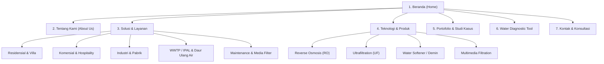
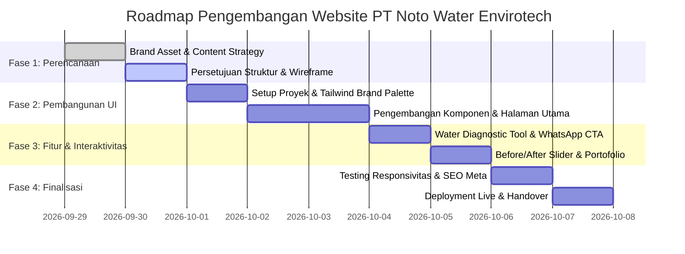

# Perencanaan Pengembangan Website Company Profile
# PT Noto Water Envirotech (NOTO)

> **Dokumen Perencanaan Proyek & Panduan Desain Identitas Brand**  
> *Versi:* 1.0.0  
> *Tanggal:* 29 September 2026  
> *Basis Acuan:* `NOTO BRAND PACKAGE #2.pdf` & Analisis Kebutuhan Bisnis B2B/B2C  

---

## 1. Ringkasan Eksekutif & Identitas Brand (Brand Foundation)

Berdasarkan dokumen resmi **NOTO BRAND PACKAGE #2**, PT Noto Water Envirotech memiliki fondasi rekam jejak industri yang sangat kuat, kredibilitas tinggi, serta identitas visual modern dan futuristis.

```
       _  _  _____  _____  _____ 
      | \| ||  _  ||_   _||  _  |
      | .` || |_| |  | |  | |_| |
      |_|\_||_____|  |_|  |_____|
         WATER ENVIROTECH
   "Every Drop Counts | Drink Pure, Live Well"
```

### 1.1. Profil Inti Perusahaan
* **Nama Perusahaan:** PT Noto Water Envirotech (Brand: **NOTO**)
* **Tahun Berdiri:** 1995 (Beroperasi lebih dari 28 tahun / lebih dari 2 dekade keahlian filtrasi air)
* **Basis Utama:** Bandung, Jawa Barat, Indonesia
* **Rekam Jejak:** Lebih dari **800+ Klien/Konsumen Puas** (Residensial, Komersial, & Industri)
* **Tagline Utama:**
  * *Primary Tagline:* **"Every Drop Counts — drink pure, live well"**
  * *Value Proposition:* **"The Purity Your Water Deserves"**
  * *Brand Essence:* **"Where Purity Meets Innovation"**
* **Misi:** Memastikan akses terhadap air murni, bersih, aman, dan berkelanjutan bukan hanya sekadar kebutuhan, melainkan hak bagi setiap individu dan industri.

### 1.2. Filosofi Visual & Makna Logo
1. **Clarity in Purpose (Kejelasan Tujuan):**  
   Desain huruf **'N'** yang bersih dan lugas di dalam lingkaran oval melambangkan transparansi, solusi tanpa kompromi, dan komitmen memberikan kejelasan teknis bagi klien dalam menghadapi masalah air yang kompleks.
2. **Full Cycle & Integrity (Integritas Layanan Penuh):**  
   Bentuk oval solid yang membingkai melambangkan integritas etis serta siklus layanan menyeluruh (*end-to-end*): mulai dari *water testing*, *system design*, *deployment/installation*, hingga *aftercare & maintenance*.
3. **Fluidity & Innovation (Aliran Air & Ide Berkelanjutan):**  
   Garis dinamis di dalam logo 'N' merepresentasikan aliran air alami dan inovasi teknologi pemurnian air termutakhir yang adaptif terhadap masa depan.

---

## 2. Design System & Brand Asset Guidelines

Pengembangan website wajib mematuhi standar identitas visual resmi dari Brand Package:

### 2.1. Skema Warna Resmi (Official Color Palette)

| Nama Token | Hex Code | Makna Brand | Peruntukan UI |
| :--- | :--- | :--- | :--- |
| **Noto Navy (Dark)** | `#092534` | *Authority, Intelligence, Professionalism* | Warna teks utama, header navbar, footer, background section kontras tinggi, typography display |
| **Noto Ocean (Primary)**| `#2B6F8B` | *Trust, Dependability, Stability, Security* | Elemen brand utama, card header, border aksen, secondary button, ikon fitur |
| **Noto Cyan (Accent)** | `#12AABF` | *Innovation, Fluidity, Cutting-Edge, Freshness* | Primary Call-to-Action (CTA), hover states, status indicator, highlight banner, gradient accents |
| **Noto Ice (Soft Light)**| `#DCEDFA` | *Purity, Clean Water, Clarity* | Background section sekunder, badge pill, card highlight, soft borders, visual depth |
| **Pure White** | `#FFFFFF` | *Sterility & Cleanliness* | Background canvas utama, text on dark, card container |
| **Neutral Slate** | `#F8FAFC` | *Subtle Balance* | Background selang-seling section agar visual nyaman di mata |

#### Rekomendasi Tailwind CSS Palette
```javascript
// tailwind.config.js
module.exports = {
  theme: {
    extend: {
      colors: {
        noto: {
          navy: '#092534',
          ocean: '#2B6F8B',
          cyan: '#12AABF',
          ice: '#DCEDFA',
          slate: '#F8FAFC',
        }
      }
    }
  }
}
```

### 2.2. Tipografi (Typography Hierarchy)
* **Display & Heading:**  
  * *Brand Guideline:* **Alte Haas Grotesk** (Modern, rounded-corner Helvetica-style grotesk).
  * *Web & Google Font Alternative:* **Plus Jakarta Sans** (sangat modern, keterbacaan tinggi di layar, mendukung aksen Indonesia/Inggris) atau **Space Grotesk** untuk kesan teknologi industri air.
* **Body & UI Elements:**  
  * **Inter** atau **Plus Jakarta Sans** (Weight: 400 Regular, 500 Medium, 600 Semi-Bold, 700 Bold).

### 2.3. Aset Visual yang Telah Diekstraksi
Aset resmi telah diekstrak langsung dari file PDF ke direktori `assets/brand/`:
* `assets/brand/page5_img3_X10.png`: Logo Mark Transparan Resolusi Tinggi (2048x2048)
* `assets/brand/page10_img2_X8.png`: Logo Lockup Landscape (3000x2200)
* `assets/brand/page1_img1_X4.jpg`: Hero Image Air Murni & Kemurnian Alami (1920x1280)
* `assets/brand/page4_img1_X4.jpg` & `page4_img4_X11.jpg`: Fotografi Brand Ultra High-Definition (5184x3456)
* `assets/brand/page13_img1_X4.jpg`: Brand Photography "The Purity Your Water Deserves" (4514x3009)

---

## 3. Tujuan Strategis Website

1. **Membangun Otoritas & Kredibilitas Instan (Instant Trust):**  
   Menonjolkan pengalaman sejak **1995 di Bandung** dan portofolio **800+ klien** untuk langsung menepis keraguan calon klien B2B maupun residensial.
2. **Konversi Penjualan Tinggi (High-Converting Inbound Leads):**  
   Memudahkan calon klien langsung terhubung ke konsultan teknis melalui tombol WhatsApp interaktif dengan pesan otomatis sesuai jenis kebutuhan air.
3. **Edukasi & Problem Solving:**  
   Menyediakan fitur **"Water Problem Diagnostic"** interaktif sehingga calon pelanggan tahu persis sistem apa yang mereka butuhkan (misal: air keruh, bau besi, kapur keras, atau kebutuhan WWTP industri).
4. **Katalog Solusi & Produk yang Terstruktur:**  
   Memisahkan segmentasi pasar secara jelas antara Residensial (Rumah Tangga/Villa) dan Komersial/Industri (Pabrik, Rumah Sakit, Hotel, Gedung).

---

## 4. Arsitektur Informasi & Struktur Halaman (Sitemap)



---

## 5. Rencana Detail Konten Setiap Section / Halaman

### 5.1. Beranda (Homepage) — Single-Page Flow dengan Sub-Halaman

1. **Top Bar & Navigation:**
   * Logo NOTO resmi (kiri).
   * Menu: Beranda, Tentang Kami, Solusi, Teknologi, Portofolio, Diagnostik Air, Kontak.
   * Action Button: **"Konsultasi Gratis (WhatsApp)"** (Pill Button warna `#12AABF` dengan ikon WhatsApp).

2. **Hero Section (First Impression):**
   * *Headline:* **Kemurnian Air yang Layak Anda Dapatkan.** (*The Purity Your Water Deserves*)
   * *Subheadline:* Solusi pengolahan air bersih & filtrasi terintegrasi sejak 1995. Lebih dari 800+ mitra industri, komersial, dan residensial di seluruh Indonesia telah mempercayakan kualitas air mereka kepada NOTO.
   * *CTA Button 1:* **Jelajahi Solusi Kami** (Solid `#12AABF`)
   * *CTA Button 2:* **Uji Masalah Air Anda** (Outline `#2B6F8B`)
   * *Trust Badges:*
     * 🏅 **Sejak 1995** (28+ Tahun Dedikasi di Bandung)
     * 👥 **800+ Klien Terlayani**
     * 💧 **100% Guaranteed Water Quality Standard**
     * 🔄 **Full-Cycle Support** (Desain, Instalasi, Maintenance)

3. **Problem-Solution Matrix (Mengapa NOTO?):**
   * Menampilkan masalah air umum:
     * Air Berbau Besi / Berwarna Karat
     * Air Berkerak Putih / Kapur Tinggi (Hard Water)
     * Air Keruh / Lumpur / Bakteri
     * Kebutuhan Standar Air Industri & Medis (TDS Rendah / Sterile)
     * Pemenuhan Baku Mutu Limbah Cair (WWTP / IPAL)
   * Menyandingkan dengan solusi rekayasa terukur dari NOTO.

4. **Kategori Solusi Utama (Solutions Grid):**
   * **Residensial & Villa Premium:** Sistem filtrasi air sumur & PDAM siap minum, anti-kapur, air mandi jernih & lembut.
   * **Komersial & Hospitality (Hotel, Resto, Cafe):** Air standar F&B, perlindungan mesin espresso & boiler dari kerak.
   * **Industri & Manufaktur:** Water Treatment Plant (WTP) debit besar, demineralisasi, dan RO industri.
   * **Wastewater Treatment (WWTP / IPAL):** Pengolahan limbah cair industri ramah lingkungan sesuai regulasi pemerintah.
   * **Layanan Pemeliharaan (Maintenance & Re-media):** Penggantian pasir silika, karbon aktif, resin kation-anion, dan servis rutin berkala.

5. **Teknologi Unggulan (Core Technologies):**
   * *Reverse Osmosis (RO) System*
   * *Ultrafiltration (UF) Technology*
   * *Ion Exchange Demineralizer & Softener*
   * *Sand, Carbon, & Manganese Multi-Media Filter*
   * *UV Sterilizer & Ozone Generator*

6. **The NOTO Full-Cycle Service Workflow:**
   * **Langkah 1: Survey & Uji Laboratorium Air** (Analisis TDS, pH, Fe, Mn, Hardness).
   * **Langkah 2: Custom Engineering & System Design** (Perancangan kapasitas & spesifikasi sesuai kondisi air baku).
   * **Langkah 3: Precision Deployment & Installation** (Pemasangan rapi oleh teknisi berpengalaman).
   * **Langkah 4: Routine Aftercare & Quality Audit** (Jaminan kualitas air jangka panjang & ketersediaan sparepart/media).

7. **Interactive Feature: "Water Solution Diagnostic Wizard":**
   * Mini-kuis 3 langkah:
     1. Apa jenis properti Anda? (Rumah / Pabrik / Hotel / Restoran)
     2. Apa sumber & kendala air utama Anda? (Sumur / PDAM / Bau / Keruh / Kapur / Limbah)
     3. Berapa perkiraan kebutuhan harian Anda?
   * *Output:* Rekomendasi sistem + tombol langsung kirim rangkuman kebutuhan ke WhatsApp NOTO.

8. **Portofolio & Klien Kami:**
   * Grid foto proyek instalasi nyata di lapangan.
   * Testimoni klien (Hotel, Pabrik Manufaktur, Rumah Sakit, Pemilik Rumah).

9. **Call To Action & Contact Section:**
   * Alamat kantor pusat di Bandung.
   * Peta Google Maps interaktif.
   * Form pertanyaan & Direct WhatsApp Chat.

10. **Footer Modern:**
    * Logo NOTO dengan deskripsi brand singkat.
    * Navigasi cepat, kontak, jam operasional, link media sosial.
    * Copyright © 2026 PT Noto Water Envirotech. All Rights Reserved.

---

## 6. Fitur Interaktif & UX Modern

1. **WhatsApp Direct Router:**
   * Floating WhatsApp button di sudut kanan bawah dengan animasi subtle pulse.
   * Format pesan pre-filled otomatis:
     > *"Halo Tim NOTO Water Envirotech, saya ingin konsultasi mengenai sistem filtrasi air untuk [Kebutuhan: Rumah/Pabrik/Hotel]. Mohon informasi lebih lanjut."*
2. **Before / After Interactive Slider:**
   * Slider perbandingan visual air keruh/kuning sebelum vs air jernih kristal setelah melewati filter NOTO.
3. **Filter Media Replacement Calculator:**
   * Estimasi kapan media filter (karbon, pasir, resin) perlu dilakukan *backwash* atau *replacement*.
4. **Bilingual Support Ready (ID / EN):**
   * Desain konten disiapkan mendukung Bahasa Indonesia dan Bahasa Inggris untuk klien multinasional.

---

## 7. Rekomendasi Arsitektur Teknologi (Tech Stack)

| Komponen | Pilihan Rekomendasi | Alasan & Keunggulan |
| :--- | :--- | :--- |
| **Framework / Core** | **Vite + Vanilla JS / Alpine.js** (atau **Astro**) | Sangat ringan, loading instan (< 1 detik), SEO-friendly, tanpa overhead komputasi berlebih. |
| **Styling** | **Tailwind CSS v3/v4** | Utilitas styling modern, mudah menerapkan warna brand NOTO secara konsisten, responsif mobile 100%. |
| **Icons** | **Lucide Icons** / **FontAwesome** | Ikon modern, tajam, dan mendukung visual bertema air, filter, sains, dan industri. |
| **Animasi & Interaksi**| **AOS (Animate On Scroll)** / **GSAP** | Efek *smooth reveal* saat scrolling menambah kesan profesional premium. |
| **SEO & Meta Tags** | **OpenGraph, Schema.org LocalBusiness** | Optimalisasi pencarian di Google ("water filter Bandung", "WTP industri", dsb). |
| **Hosting & Deployment**| **Cloudflare Pages / Vercel / Netlify** | Gratis, performa global CDN cepat, SSL otomatis, zero-maintenance. |

---

## 8. Rencana Implementasi & Roadmap Pengembangan



### Tahapan Kerja:
* **Milestone 1 (Selesai):** Analisis `NOTO BRAND PACKAGE #2.pdf`, ekstraksi aset gambar resolusi tinggi, dan penyusunan dokumen perencanaan komprehensif ini.
* **Milestone 2:** Konfirmasi struktur & fitur bersama pengguna (Apakah ada prioritas khusus produk atau data kontak spesifik seperti alamat/no WA Bandung).
* **Milestone 3:** Pembuatan prototype website interaktif (lengkap dengan Tailwind CSS, logo NOTO, palet warna resmi, dan form konsultasi).
* **Milestone 4:** Review visual & integrasi nomor kontak nyata / detail portofolio.
* **Milestone 5:** Peluncuran (*live deployment*).

---

## 9. Struktur Folder Proyek yang Direkomendasikan

```
Noto Asia/
├── NOTO BRAND PACKAGE #2.pdf    # Dokumen Brand Resmi
├── PROJECT_PLAN_NOTO_WATER.md   # Dokumen Perencanaan (File ini)
├── assets/
│   ├── brand/                   # Aset mentah hasil ekstraksi PDF
│   ├── img/                     # Foto hero, fasilitas, dan proyek
│   └── logo/                    # Vektor & PNG logo NOTO transparan
├── src/                         # Source code website
│   ├── css/                     # Tailwind & custom CSS
│   ├── js/                      # Interaktivitas & Diagnostic Tool
│   └── components/              # Komponen UI modular
├── index.html                   # Halaman Utama Company Profile
└── package.json                 # Konfigurasi dependensi & build script
```

---

*Dokumen ini siap ditinjau dan dieksekusi ke tahap pembuatan kode website.*
